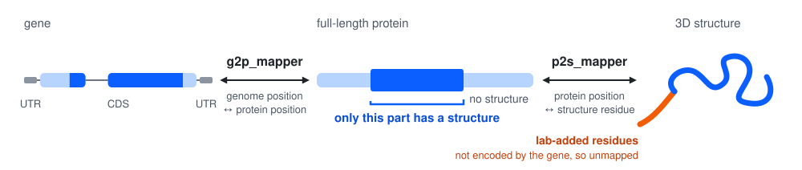
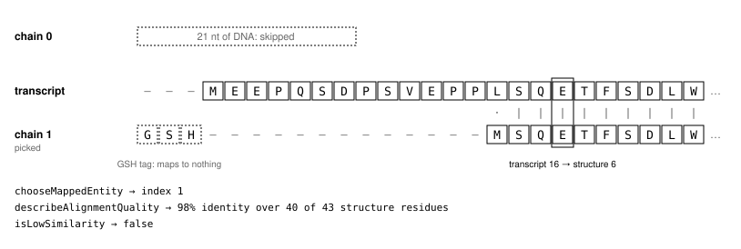

# p2s_mapper

Lines up a protein sequence with its 3D structure, residue by residue.

- **Input:** a protein sequence, and an AlphaFold or PDB structure
- **Output:** which 3D residue each amino acid is, and back



A PDB entry often holds only part of the protein (dark blue above), plus
residues the lab added (orange), so a protein position is not a structure
position.

- Picks the chain in the structure file that is your protein, skipping DNA and
  RNA, and checks the match is not chance
- Converts positions between transcript, structure and Mol\*, and gives each
  residue its author number
- Places UniProt annotations on a PDB entry
- Finds AlphaFold and PDB structures for a gene, the complexes AlphaFold
  predicted with it, and Foldseek hits
- Works with [g2p_mapper](https://github.com/GMOD/g2p_mapper) for genome ↔
  protein ↔ 3D residue
- No React, JBrowse or Mol\* dependency
- Used by
  [jbrowse-plugin-protein3d](https://github.com/GMOD/jbrowse-plugin-protein3d)

## Install

```
npm install p2s_mapper
```

## Usage

### Map a transcript onto a structure

Find which chain of a structure is your protein, then convert positions.



- `chooseMappedEntity` picks the chain that matches the transcript
- `isLowSimilarity` checks the match is not chance
- `makeCoordinateMapper` converts positions both ways

```ts
import {
  alignmentQuality,
  chooseMappedEntity,
  describeAlignmentQuality,
  isLowSimilarity,
  makeCoordinateMapper,
  structurePos,
  transcriptPos,
} from 'p2s_mapper'

// the first 58 residues of p53 plus a stop, and a structure holding a DNA strand
// and a tagged fragment
const transcript = 'MEEPQSDPSVEPPLSQETFSDLWKLLPENNVLSPLPSQAMDDLMLSPDDIEQWFTEDP*'
const chains = [
  { seq: 'TTTCCTAGACTTGCCCAATTA', nucleicAcid: true },
  { seq: 'GSHMSQETFSDLWKLLPENNVLSPLPSQAMDDLMLSPDDIEQW' },
]

const picked = chooseMappedEntity(transcript, chains, 'smith_waterman')
if (picked) {
  picked.index // 1: the protein chain

  const quality = alignmentQuality(picked.alignment)
  isLowSimilarity(quality) // false
  describeAlignmentQuality(quality)
  // '98% identity over 40 of 43 structure residues'

  const mapper = makeCoordinateMapper(picked.alignment)
  mapper.transcriptToStructure(transcriptPos(16)) // 6
  mapper.structureToTranscript(structurePos(6)) // 16
  mapper.structureToTranscript(structurePos(0)) // undefined: the GSH tag
}
```

Positions are 0-based. Transcript and structure positions are separate types, so
mixing them up is a compile error.

### From a genome position to a residue, and back

Click a base to highlight its residue in 3D, or hover a residue to highlight its
codon. g2p_mapper handles genome ↔ protein, p2s_mapper the rest.

```ts
import { genomeToTranscriptSeqMapping } from 'g2p_mapper'
import {
  chooseMappedEntity,
  codonGenomeSpan,
  makeCoordinateMapper,
  makeLabelSeqIdIndex,
  residueNumber,
  structurePos,
  toLabelSeqIds,
  transcriptPos,
} from 'p2s_mapper'
import type { Entity } from 'p2s_mapper'

const transcript = 'MEEPQSDPSVEPPLSQETFSDLWKLLPENNVLSPLPSQAMDDLMLSPDDIEQWFTEDP*'
const { g2p, p2gCodon } = genomeToTranscriptSeqMapping({
  refName: 'chr17',
  start: 1000,
  end: 2117,
  strand: 1,
  subfeatures: [
    { refName: 'chr17', start: 1000, end: 1060, type: 'CDS', phase: 0 },
    { refName: 'chr17', start: 2000, end: 2117, type: 'CDS' },
  ],
})

// normally from extractEntities(model); here the author numbering starts at 12
const entity: Entity = {
  entityId: '1',
  seq: 'GSHMSQETFSDLWKLLPENNVLSPLPSQAMDDLMLSPDDIEQW',
  seqIds: Array.from({ length: 43 }, (_, i) => i + 1),
  authSeqIds: Array.from({ length: 43 }, (_, i) => i + 12),
  chains: ['A'],
}
const picked = chooseMappedEntity(transcript, [entity], 'smith_waterman')!
const mapper = makeCoordinateMapper(picked.alignment)

// genome -> structure
const proteinPos = g2p[2000] // 20
if (proteinPos !== undefined) {
  const pos = mapper.transcriptToStructure(transcriptPos(proteinPos)) // 10
  if (pos !== undefined) {
    toLabelSeqIds(entity, [pos]) // [11]: what to highlight in Mol*
    residueNumber(entity, pos) // 22: what to show the user
  }
}

// a Mol* hover on label_seq_id 15 -> genome
const hovered = makeLabelSeqIdIndex(entity).get(15) // 14
if (hovered !== undefined) {
  const t = mapper.structureToTranscript(structurePos(hovered)) // 24
  if (t !== undefined) {
    codonGenomeSpan(p2gCodon, t) // [2012, 2015]
  }
}
```

### With a structure loaded in Mol\*

The same mapping, with chains read from a loaded Mol\* model. `StructureModel`
lists the fields `extractEntities` reads, so the package needs no Mol\* import.

```ts
import {
  chooseMappedEntity,
  extractEntities,
  rangeToLabelSeqIds,
} from 'p2s_mapper'
import type { StructureModel } from 'p2s_mapper'

// e.g. what plugin.builders.structure.createModel resolves to
declare const model: StructureModel
declare const transcript: string

const entities = extractEntities(model) ?? []
const picked = chooseMappedEntity(transcript, entities, 'smith_waterman')
const entity = picked ? entities[picked.index] : undefined

// the label_seq_ids of structure positions 10-19, for a Mol* selection
rangeToLabelSeqIds(entity, { start: 10, end: 20 })
```

### Find a structure for a gene

From a gene name to a structure file: look the gene up in UniProt, then take its
AlphaFold model or best PDB entry.

```ts
import {
  fetchAlphaFoldModels,
  fetchExperimentalStructures,
  getPdbStructureUrl,
  pickAlphaFoldModel,
  searchUniProtEntries,
} from 'p2s_mapper'

declare const translation: string

const { entries } = await searchUniProtEntries({
  recognizedIds: ['GeneID:7157', 'ENST00000269305'],
  geneName: 'TP53',
  organismId: 9606,
})
const accession = entries[0]?.accession // 'P04637'

if (accession) {
  // predicted: the model folded from this exact translation, else the canonical one
  const models = await fetchAlphaFoldModels(accession)
  const predicted = pickAlphaFoldModel(models, { tx1: { seq: translation } })

  // experimental: PDB entries, best coverage first
  const [best] = await fetchExperimentalStructures(accession)
  const url = predicted?.url ?? (best && getPdbStructureUrl(best.pdbId))
}
```

Network functions take `{ fetch?, signal? }` last, for a custom fetch or an
`AbortSignal`.

### Place UniProt annotations on a PDB entry

A PDB entry is often a fragment, so a UniProt position (a domain, a variant)
needs converting to a structure position before you can highlight it.

```ts
import {
  chooseUniProtMappingForEntity,
  fetchUniProtStructureMappings,
  makeUniProtPositionMap,
} from 'p2s_mapper'

const mappings = await fetchUniProtStructureMappings('1tup')
const mapping = chooseUniProtMappingForEntity(mappings, {
  entityId: '3',
  chains: ['A', 'B', 'C'],
})
const toStructure = makeUniProtPositionMap(mapping?.segments ?? [])
toStructure(248) // 154: UniProt residue 248 is structure position 154
```

## Docs

- [api.md](docs/api.md): every export, with its signature, types and an example
- [pipeline.md](docs/pipeline.md): the steps from a gene to a residue
- [coordinates.md](docs/coordinates.md): residue numbering systems and
  conversion functions
- [faq.md](docs/faq.md): how far to trust the mapping

## Pitfalls

- **Counting from 0 or 1:** every position is 0-based, except UniProt positions
  and author residue numbers, which are 1-based. See
  [coordinates.md](docs/coordinates.md).
- **Which alignment row is which:** row 0 is the transcript and row 1 the
  structure. Read them with `transcriptAlignedSeq` and `structureAlignedSeq`.
- **A bad match still returns a chain:** `chooseMappedEntity` returns the
  closest chain even when it is poor, so check `isLowSimilarity` first.
- **Selecting in Mol\*:** use `toLabelSeqIds`, not position + 1. They agree only
  when the file has `entity_poly_seq` or SEQRES.

## See also

- https://github.com/GMOD/proteinbrowser
- https://github.com/GMOD/g2p_mapper
- https://github.com/GMOD/domains2genome
- https://github.com/GMOD/jbrowse-plugin-protein3d

## License

MIT
