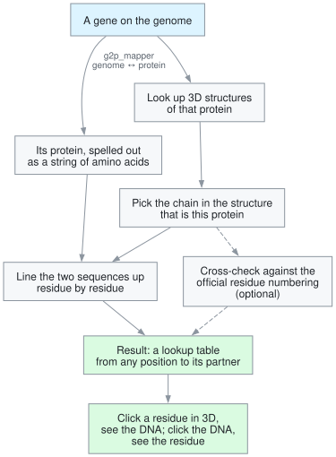

# p2s_mapper

Lines up a protein sequence with its 3D structure, residue by residue.

- **Input:** a protein sequence, and an AlphaFold or PDB structure
- **Output:** which 3D residue each amino acid is, and back

Functionality

- Picks the right chain and flags a poor match
- Finds structures for a gene
- Places UniProt annotations on a PDB entry
- Works alongside [g2p_mapper](https://github.com/GMOD/g2p_mapper) to map genome position ↔ protein sequence ↔ 3D
  residue
- No React, JBrowse or Mol\* dependency
- Used by
  [jbrowse-plugin-protein3d](https://github.com/GMOD/jbrowse-plugin-protein3d)

## Install

```
npm install p2s_mapper
```

## Usage

### Map a transcript onto a structure

Pass the transcript's translation and the structure's chain sequences.
`chooseMappedEntity` picks the chain, `isLowSimilarity` checks the match is not
chance, and `makeCoordinateMapper` converts positions both ways.

```ts
import {
  alignmentQuality,
  chooseMappedEntity,
  describeAlignmentQuality,
  isLowSimilarity,
  makeCoordinateMapper,
  structurePos,
  transcriptPos,
} from 'p2s_mapper'

// p53's N-terminus, and a structure holding a DNA strand and a tagged fragment
const transcript = 'MEEPQSDPSVEPPLSQETFSDLWKLLPENNVLSPLPSQAMDDLMLSPDDIEQWFTEDP*'
const chains = [
  { seq: 'TTTCCTAGACTTGCCCAATTA', nucleicAcid: true },
  { seq: 'GSHMSQETFSDLWKLLPENNVLSPLPSQAMDDLMLSPDDIEQW' },
]

const picked = chooseMappedEntity(transcript, chains, 'smith_waterman')
if (picked) {
  picked.index // 1: the protein chain

  const quality = alignmentQuality(picked.alignment)
  isLowSimilarity(quality) // false
  describeAlignmentQuality(quality)
  // '98% identity over 40 of 43 structure residues'

  const mapper = makeCoordinateMapper(picked.alignment)
  mapper.transcriptToStructure(transcriptPos(16)) // 6
  mapper.structureToTranscript(structurePos(6)) // 16
  mapper.structureToTranscript(structurePos(0)) // undefined: the GSH tag
}
```

Every position is 0-based. Structure and transcript positions are separate
types, so passing one where the other belongs is a compile error.

### From a genome position to a residue, and back

g2p_mapper maps genome positions to protein positions. p2s_mapper maps a protein
position to a structure position, and that to the `label_seq_id` Mol\* uses to
select a residue.

```ts
import { genomeToTranscriptSeqMapping } from 'g2p_mapper'
import {
  chooseMappedEntity,
  codonGenomeSpan,
  makeCoordinateMapper,
  makeLabelSeqIdIndex,
  residueNumber,
  structurePos,
  toLabelSeqIds,
  transcriptPos,
} from 'p2s_mapper'
import type { Entity } from 'p2s_mapper'

const transcript = 'MEEPQSDPSVEPPLSQETFSDLWKLLPENNVLSPLPSQAMDDLMLSPDDIEQWFTEDP*'
const { g2p, p2gCodon } = genomeToTranscriptSeqMapping({
  refName: 'chr17',
  start: 1000,
  end: 2117,
  strand: 1,
  subfeatures: [
    { refName: 'chr17', start: 1000, end: 1060, type: 'CDS', phase: 0 },
    { refName: 'chr17', start: 2000, end: 2117, type: 'CDS' },
  ],
})

// normally from extractEntities(model); here the author numbering starts at 12
const entity: Entity = {
  entityId: '1',
  seq: 'GSHMSQETFSDLWKLLPENNVLSPLPSQAMDDLMLSPDDIEQW',
  seqIds: Array.from({ length: 43 }, (_, i) => i + 1),
  authSeqIds: Array.from({ length: 43 }, (_, i) => i + 12),
  chains: ['A'],
}
const picked = chooseMappedEntity(transcript, [entity], 'smith_waterman')!
const mapper = makeCoordinateMapper(picked.alignment)

// genome -> structure
const proteinPos = g2p[2000] // 20
if (proteinPos !== undefined) {
  const pos = mapper.transcriptToStructure(transcriptPos(proteinPos)) // 10
  if (pos !== undefined) {
    toLabelSeqIds(entity, [pos]) // [11]: what to highlight in Mol*
    residueNumber(entity, pos) // 22: what to show the user
  }
}

// a Mol* hover on label_seq_id 15 -> genome
const hovered = makeLabelSeqIdIndex(entity).get(15) // 14
if (hovered !== undefined) {
  const t = mapper.structureToTranscript(structurePos(hovered)) // 24
  if (t !== undefined) {
    codonGenomeSpan(p2gCodon, t) // [2012, 2015]
  }
}
```

### With a structure loaded in Mol\*

`extractEntities` reads each chain's sequence, residue ids and numbering from a
loaded Mol\* model. `StructureModel` lists the fields it reads, so the package
needs no Mol\* import.

```ts
import {
  chooseMappedEntity,
  extractEntities,
  rangeToLabelSeqIds,
} from 'p2s_mapper'
import type { StructureModel } from 'p2s_mapper'

// e.g. what plugin.builders.structure.createModel resolves to
declare const model: StructureModel
declare const transcript: string

const entities = extractEntities(model) ?? []
const picked = chooseMappedEntity(transcript, entities, 'smith_waterman')
const entity = picked ? entities[picked.index] : undefined

// the label_seq_ids of structure positions 10-19, for a Mol* selection
rangeToLabelSeqIds(entity, { start: 10, end: 20 })
```

### Find a structure for a gene

```ts
import {
  fetchAlphaFoldModels,
  fetchExperimentalStructures,
  getPdbStructureUrl,
  pickAlphaFoldModel,
  searchUniProtEntries,
} from 'p2s_mapper'

declare const translation: string

const { entries } = await searchUniProtEntries({
  recognizedIds: ['GeneID:7157', 'ENST00000269305'],
  geneName: 'TP53',
  organismId: 9606,
})
const accession = entries[0]?.accession // 'P04637'

if (accession) {
  // predicted: the model folded from this exact translation, else the canonical one
  const models = await fetchAlphaFoldModels(accession)
  const predicted = pickAlphaFoldModel(models, { tx1: { seq: translation } })

  // experimental: PDB entries, best coverage first
  const [best] = await fetchExperimentalStructures(accession)
  const url = predicted?.url ?? (best && getPdbStructureUrl(best.pdbId))
}
```

Every network function takes `{ fetch?, signal? }` last, defaulting to
`globalThis.fetch`, so the caller can pass a custom fetch and an `AbortSignal`.

### Place UniProt annotations on a PDB entry

A PDB construct is usually a fragment, numbered differently from UniProt.
`fetchUniProtStructureMappings` reads the entry's alignment to UniProt from
RCSB.

```ts
import {
  chooseUniProtMappingForEntity,
  fetchUniProtStructureMappings,
  makeUniProtPositionMap,
} from 'p2s_mapper'

const mappings = await fetchUniProtStructureMappings('1tup')
const mapping = chooseUniProtMappingForEntity(mappings, {
  entityId: '3',
  chains: ['A', 'B', 'C'],
})
const toStructure = makeUniProtPositionMap(mapping?.segments ?? [])
toStructure(248) // 154: UniProt residue 248 is structure position 154
```

## Graphical overview



## Docs

- [api.md](docs/api.md): every export, with its signature, types and an example
- [pipeline.md](docs/pipeline.md): step by step 'pipeline' overview
- [coordinates.md](docs/coordinates.md): residue numbering systems and
  conversion functions
- [faq.md](docs/faq.md): FAQs... for example, can I trust this mapping?

## Pitfalls

- Positions are **0-based**, except UniProt positions and author residue
  numbers, which are 1-based. See [coordinates.md](docs/coordinates.md).
- A `PairwiseAlignment` has **row 0 = transcript, row 1 = structure**. Read the
  rows with `transcriptAlignedSeq` and `structureAlignedSeq`.
- `chooseMappedEntity` returns the best-matching chain even when the match is
  poor. Check it with `isLowSimilarity` before trusting the mapping.
- Get Mol\*'s `label_seq_id` from `toLabelSeqIds`, which reads `Entity.seqIds`.
  Adding 1 to the position gives the wrong residue in a PDB file without SEQRES.

## License

MIT
