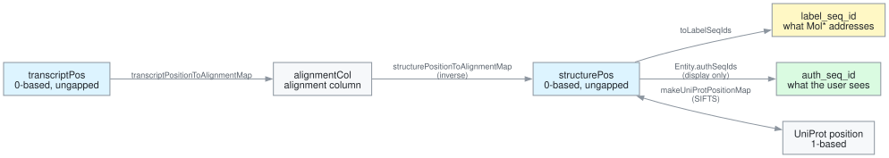

# Coordinate conventions

A residue can have up to four numbers, and mixing them up causes off-by-one
errors. The package's position types catch most of those at compile time.

## Positions

**Every coordinate the package stores or computes is a 0-based position**: an
index into the ungapped structure sequence or the ungapped transcript sequence.
Positions have no gaps and start at 0 whatever the file.

`coordinates.ts` defines a separate type for each kind of position, so the
compiler rejects mixing them:

- `structurePos`: an index into the ungapped structure sequence
- `transcriptPos`: an index into the ungapped transcript sequence
- `alignmentCol`: a column of the pairwise alignment

## Numberings outside the package

Two numberings outside the package need a conversion, and each has one correct
function or field.

### Mol\* selects residues by `label_seq_id`

`label_seq_id` is `position + 1` only in a file with `entity_poly_seq` or
SEQRES. In a PDB file without SEQRES, the observed residues have their author
numbers as ids, with gaps at unobserved loops, so `Entity.seqIds` lists the real
ids. Convert with one of:

- `toLabelSeqIds`
- `rangeToLabelSeqIds`
- `makeLabelSeqIdIndex`, for `label_seq_id` back to a position

### The user sees `auth_seq_id`

`auth_seq_id` is the depositors' numbering, which papers and UniProt cite and
Mol\*'s hover shows: in 1TUP, position 154 is residue 248. `Entity.authSeqIds`
lists it; use it for display only, and don't pass it to a coordinate map.

## UniProt positions

UniProt positions are 1-based. `makeUniProtPositionMap` converts them with the
entry's UniProt alignment, without assuming a fixed offset.
